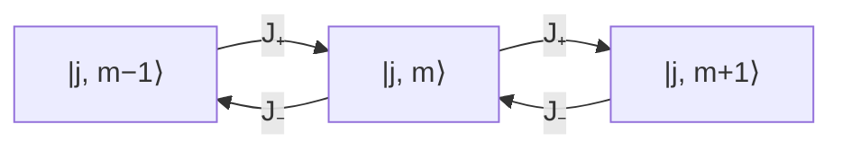

The whole angular-momentum spectrum follows from the commutation relations. No wavefunctions,
no differential equations — just algebra.

## The starting point

$$
[J_i, J_j] = i\hbar\,\varepsilon_{ijk} J_k
$$

Because $J^2$ commutes with every component, we can label states by $J^2$ and one component,
conventionally $J_z$: the states $\ket{j, m}$.

## Raising and lowering

Define $J_\pm = J_x \pm i J_y$. The key relation is

$$
[J_z, J_\pm] = \pm \hbar J_\pm,
$$

which says that $J_\pm \ket{j,m}$ is still an eigenstate of $J_z$, with eigenvalue shifted by
$\pm\hbar$. So the operators step you along the ladder:

## Why the ladder terminates

The norm $\lVert J_\pm \ket{j,m} \rVert^2 = \hbar^2\left[j(j+1) - m(m \pm 1)\right]$ cannot be
negative. That single inequality bounds $m$ above and below, forcing the ladder to stop — which
is what quantises $j$ into integers and half-integers.

## Still unclear to me

- The half-integer case has no wavefunction realisation. I can state why; I can't yet *see* it.
- Where exactly the $\varepsilon_{ijk}$ enters when deriving this from rotational invariance
  rather than assuming it.
